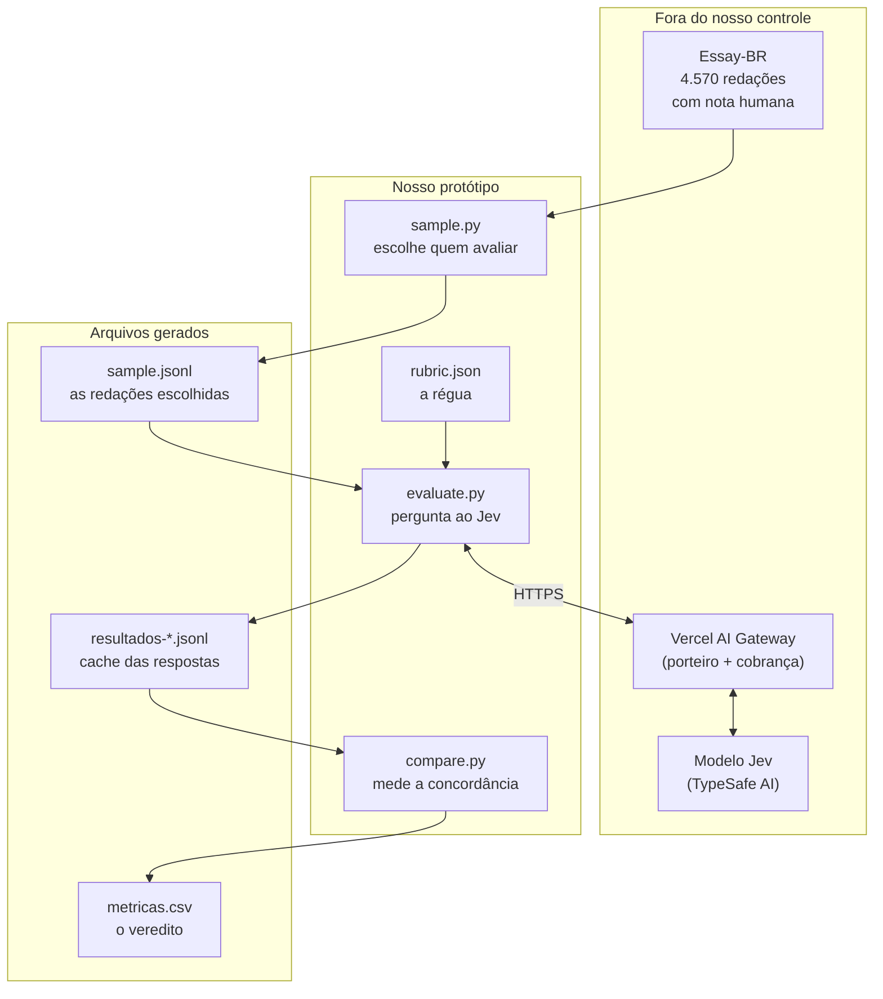
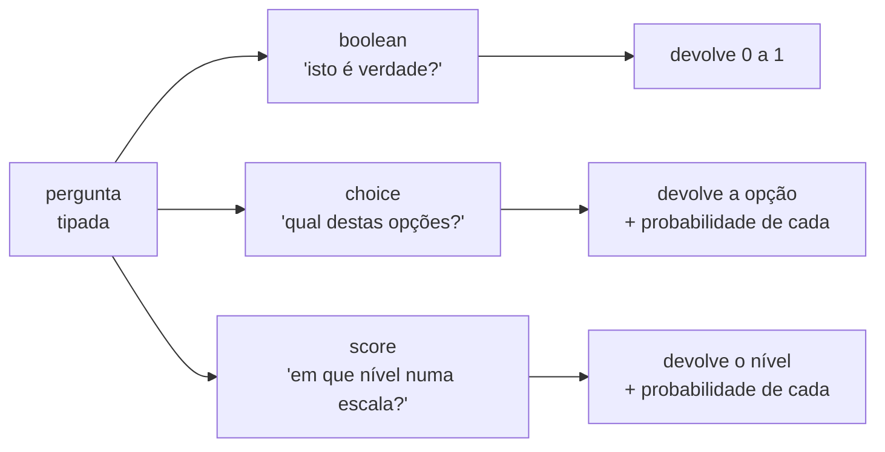
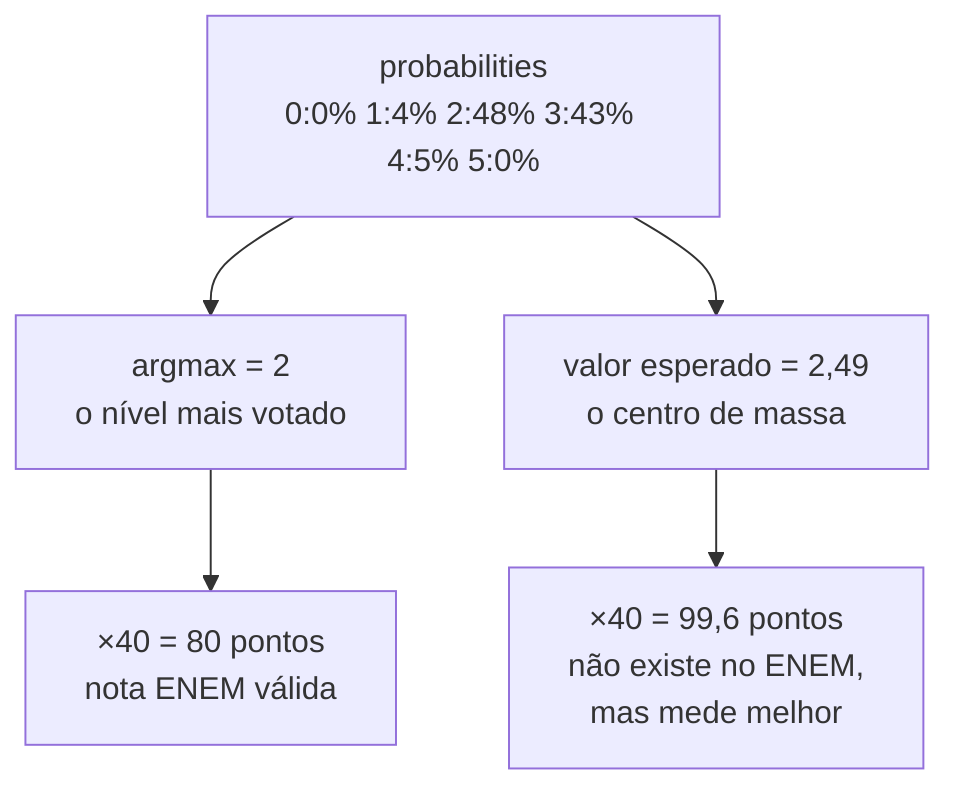
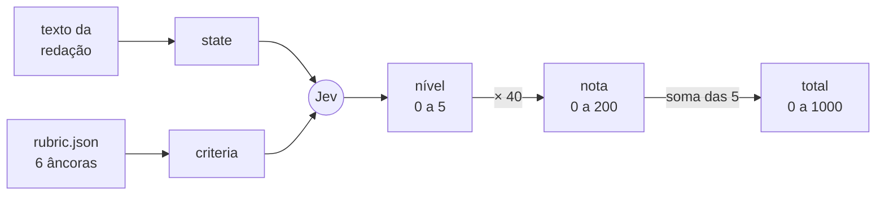
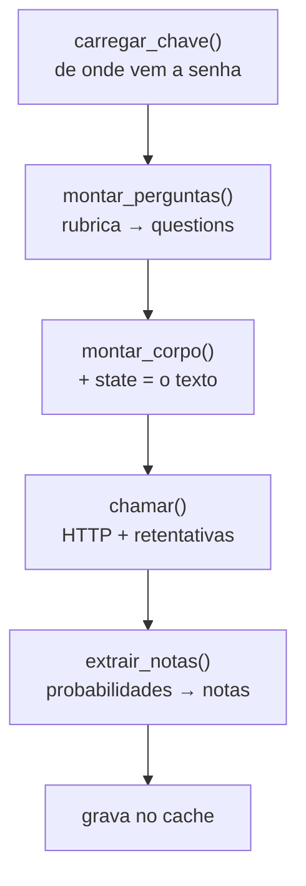
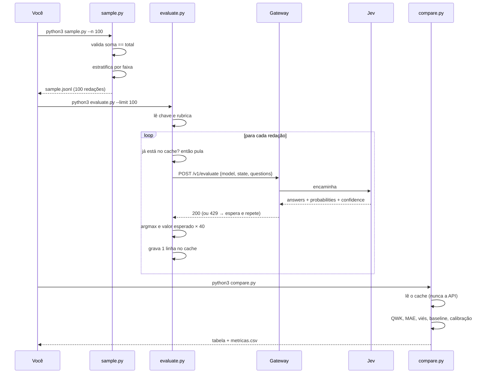

# Arquitetura do LAB Jev — guia didático

> Objetivo deste documento: você deve terminar capaz de **redesenhar o sistema numa
> folha em branco**, e de prever o que cada arquivo faz antes de abri-lo.

---

## 1. Em uma frase

Nós pegamos redações que **já têm nota dada por humanos**, pedimos ao modelo Jev que
dê a nota dele, e medimos o quanto os dois concordam.

Se concordarem muito, o Jev pode virar um corretor automático. Se concordarem pouco,
descobrimos onde ele erra — e é isso que temos hoje.

---

## 2. A ideia central: dois tipos de IA

Este é o conceito que sustenta tudo. Guarde-o primeiro.

Existem dois jeitos muito diferentes de usar um modelo de linguagem:

| | **LLM generativo** (ChatGPT, Claude) | **Modelo de decisão** (Jev) |
|---|---|---|
| O que devolve | Texto livre | Um valor **tipado** + probabilidades |
| Analogia | Um ensaísta que escreve um parecer | Um avaliador com prancheta que marca X num formulário |
| Você pergunta | "Avalie esta redação" | "Numa escala de 6 níveis, qual o nível da gramática?" |
| Resposta | Três parágrafos de opinião | `nível 2, confiança 0,62` |
| Problema típico | Você precisa **extrair** o número do texto | Nenhum: o número já vem como número |

**Tipado** significa que o formato da resposta é decidido *antes* da pergunta. Você não
recebe "acho que uns 120 pontos, mas depende" — você recebe um índice de 0 a 5, sempre,
com a probabilidade de cada um.

O Jev é chamado de modelo **System One** — nome emprestado da psicologia (Kahneman),
onde "Sistema 1" é o pensamento rápido e automático, e "Sistema 2" o lento e
deliberativo. O Jev é o reflexo, não a reflexão: ele decide em ~0,5 s e **não escreve
texto nenhum**.

Consequência prática: o Jev **não** é capaz de escrever o feedback para o aluno. Ele só
dá as notas. Se quisermos feedback em texto, isso é um segundo passo, com outro modelo.

---

## 3. Mapa de arquitetura



Leia o diagrama assim: **da esquerda para a direita é o caminho dos dados**. A única
seta de mão dupla é a que sai para a internet — todo o resto é um passo adiante.

Note que `compare.py` **nunca** toca o gateway. Ele lê o cache em JSONL. Isso é
deliberado e voltaremos a isso na seção de padrões.

---

## 4. A unidade básica: a pergunta tipada

Tudo no Jev gira em torno de uma **pergunta tipada**. Existem três tipos:



Nós usamos **só `score`**, porque o ENEM é exatamente isso: cada competência vale
0, 40, 80, 120, 160 ou 200 pontos. Seis níveis.

> **Pegadinha de vocabulário:** a documentação oficial da TypeSafe chama o tipo booleano
> de `noul`. O Vercel AI Gateway chama de `boolean`. São a mesma coisa com dois nomes.
> Se você mandar `noul` pelo gateway, ele recusa.

---

## 5. Anatomia da chamada

```
POST https://ai-gateway.vercel.sh/v1/evaluate
Authorization: Bearer vck_...
Content-Type: application/json
```

Três coisas no corpo, e só três:

```json
{
  "model": "typesafe-ai/jev",
  "state": "Título: A importância da cultura\n\nÉ notório que...",
  "questions": {
    "c1": {
      "type": "score",
      "instructions": "Avalie o domínio da escrita formal...",
      "criteria": [
        "âncora do nível 0",
        "âncora do nível 1",
        "... até o nível 5"
      ]
    },
    "c2": { "...": "..." },
    "c5": { "...": "..." }
  }
}
```

Os três campos, em português claro:

| Campo | O que é | Analogia |
|---|---|---|
| `model` | qual modelo usar | o nome do avaliador que você contratou |
| `state` | **o texto a ser avaliado** | a prova que você põe na mesa dele |
| `questions` | as perguntas, com a régua de cada uma | o formulário que ele preenche |

**`state` é a palavra-chave para memorizar.** Não é `messages`, não é `prompt`, não é
`input`. É `state` — "estado", porque o Jev pensa em termos de "avalie *este estado do
mundo* contra *estas perguntas*".

As 5 competências vão **numa requisição só**. O Jev lê a redação uma vez e responde as
5 perguntas em paralelo. Isso importa para o custo: você paga o texto da redação uma
vez, não cinco.

### Como uma competência vira uma pergunta

Este é o pulo do gato do projeto. Olhe o `rubric.json`:

```json
"c1": {
  "instructions": "Avalie o domínio da modalidade escrita formal...",
  "criteria": [
    "Desconhecimento total da modalidade escrita formal...",   ← nível 0
    "Domínio precário: desvios sistemáticos e graves...",      ← nível 1
    "Domínio insuficiente: muitos desvios...",                 ← nível 2
    "Domínio mediano: majoritariamente correto, mas...",        ← nível 3
    "Bom domínio: poucos desvios...",                          ← nível 4
    "Excelente domínio: desvios raros e acidentais..."         ← nível 5
  ]
}
```

`criteria` é uma **lista ordenada de âncoras**. Âncora é uma descrição do que caracteriza
aquele nível. A posição na lista **é** o nível. O Jev nunca vê a palavra "120 pontos" —
ele vê seis descrições em ordem e escolhe entre elas.

---

## 6. Anatomia da resposta

Resposta real, da redação `idx=633`, encurtada para uma competência:

```json
{
  "model": "typesafe-ai/jev",
  "answers": {
    "c1": {
      "type": "score",
      "score": 2.49,
      "probabilities": { "0": 0, "1": 0.04, "2": 0.48, "3": 0.43, "4": 0.05, "5": 0 },
      "confidence": 0.62
    }
  },
  "usage": { "inputTokens": 1850, "outputTokens": 74 }
}
```

| Campo | Significado |
|---|---|
| `answers` | um objeto por pergunta, com **a mesma chave** que você enviou (`c1`) |
| `probabilities` | quanta chance ele dá a cada nível. Soma 1,00 |
| `confidence` | quão decidido ele está. Baixo = candidato a revisão humana |
| `score` | ⚠️ **leia a próxima seção antes de usar este campo** |
| `usage` | tokens consumidos — é isso que determina o custo |

---

## 7. A pegadinha mais importante: `score` não é o nível escolhido

Olhe os números acima. O nível mais provável é o **2** (48%). Mas `score` veio **2,49**.

Por que? Porque `score` é a **média ponderada** dos níveis, não o mais votado:

```
0×0,00 + 1×0,04 + 2×0,48 + 3×0,43 + 4×0,05 + 5×0,00 = 2,49
```

Isso se chama **valor esperado**: a média de todos os resultados possíveis, cada um
pesado pela sua probabilidade. Como quando você joga um dado e diz que "em média sai
3,5" — 3,5 não é uma face do dado, é o centro de massa das possibilidades.



Guardamos **os dois**, e por motivos diferentes:

- **`nota_argmax`** (80): uma nota que o ENEM aceita. É o que você mostraria a um aluno.
- **`nota_esperada`** (99,6): não é uma nota válida — o ENEM não tem 99,6. Mas guarda a
  informação de que o Jev estava **rachado entre 2 e 3**, e por isso correlaciona melhor
  com a nota humana.

Se o Jev está 48% no nível 2 e 43% no nível 3, dizer só "nível 2" joga no lixo metade
do que ele sabe.

> **Este bug nos pegou de verdade.** A primeira versão do código tratava `score` como
> índice e fazia `2,49 × 40 = 99,6` chamando isso de `nota_argmax`. Só descobrimos ao
> rodar a primeira chamada real. Nenhuma revisão de código tinha pegado.

---

## 8. A escada de conversão

O diagrama para decorar. Da redação até a nota:



`× 40` é toda a matemática do projeto. 6 níveis × 40 = 200 pontos por competência,
5 competências = 1000 pontos. O número 40 está em um lugar só, no `rubric.json`
(`"escala": 40`), para você poder mudar a régua sem tocar o código.

---

## 9. Os quatro arquivos, um por um

### `rubric.json` — a régua (66 linhas, zero código)

As 5 competências do ENEM, cada uma com 6 âncoras. **É um arquivo de dados, não de
código.** Isso é uma decisão de arquitetura: você pode reescrever a rubrica inteira,
rodar de novo, e comparar os resultados sem nunca abrir um `.py`.

Se o Jev discordar sistematicamente do humano, o conserto é editar **este** arquivo —
não o pipeline. Medir essa discordância é a etapa 5 do workshop; consertá-la, a 6.

### `sample.py` — escolhe quem avaliar (99 linhas)

Duas responsabilidades:

**Valida os rótulos.** Confere que `soma das 5 competências == nota total` em cada linha.
Se não bater, descarta e conta. (No split de teste: 686 linhas, zero descartes.)

**Estratifica.** Aqui está a parte interessante. O corpus é concentrado: a nota 600
aparece 91 vezes, a 680 outras 79. Se sorteássemos 100 redações ao acaso, quase todas
seriam medianas, e nunca saberíamos se o Jev funciona nos extremos.

**Estratificar** = dividir a população em faixas e pegar de cada faixa, de propósito.

```
Amostra aleatória:      600 600 680 600 520 680 600 ...   ← só o meio
Amostra estratificada:  0 80 160 ... 520 600 ... 920 1000  ← toda a faixa
```

> A primeira versão desta função estava **errada** e devolvia só notas de 0 a 440 — ela
> percorria as faixas em ordem e parava ao atingir o total pedido, pegando só as mais
> baixas. O sintoma foi visível na primeira execução: `faixa de notas: 0 a 440`.

### `evaluate.py` — conversa com o Jev (260 linhas)

O único arquivo que fala com a internet. Cinco funções encadeadas:



Cada função faz uma coisa só e devolve um valor — sem efeitos escondidos. Isso se chama
**função pura**: dada a mesma entrada, sempre a mesma saída. A vantagem é que você pode
testar `extrair_notas` sem internet nenhuma, só passando um dicionário na mão (foi
exatamente assim que validamos o bug do `score`).

Três proteções que existem porque cada uma delas nos queimou:

| Proteção | O que evita |
|---|---|
| Para na 1ª falha de `401/403` | queimar 100 chamadas repetindo o mesmo erro de credencial |
| Para se `answers` vier vazio | gravar cache vazio e produzir métricas silenciosamente erradas |
| Backoff exponencial no `429` | perder 61 de 100 chamadas quando o provedor está sobrecarregado |

**Backoff exponencial**: ao receber "estou ocupado", espera 2 s, tenta de novo; se falhar,
4 s; depois 8 s. Dobrar a espera evita que todos os clientes voltem no mesmo instante e
derrubem o serviço outra vez.

### `compare.py` — mede a concordância (204 linhas)

Lê o cache e responde: **o Jev concorda com o humano?**

Cinco medidas, porque nenhuma sozinha conta a história:

| Medida | O que responde | Onde engana |
|---|---|---|
| **QWK** | concordância, descontando a sorte | difícil de interpretar sozinho |
| **MAE** | de quantos pontos ele erra, em média | não distingue errar pra cima ou pra baixo |
| **viés** | ele erra **pra cima** ou **pra baixo**? | esconde erro que se cancela |
| **exata / adj** | acertou a faixa? errou por uma só? | ignora o tamanho do erro grande |
| **r** (Pearson) | ele **ordena** bem, mesmo errando a nota? | alto mesmo com nota toda deslocada |

**QWK** (*Quadratic Weighted Kappa*) é a medida padrão para correção automática de
redação. A ideia: **1,0 = concordância perfeita, 0,0 = o mesmo que chutar**. O "quadratic"
significa que errar por 3 faixas pesa 9 vezes mais que errar por 1 — errar feio é muito
pior que errar de pouco.

Por que não usar só "% de acerto"? Porque a distribuição é concentrada. Um modelo que
responde **sempre 600** acerta ~13% das redações sem saber nada. É por isso que o relatório
imprime uma **baseline** (sempre 600): se o Jev não bater isso, ele não está aprendendo
nada. Hoje ele bate: MAE 160 contra 213.

---

## 10. O fluxo completo, do zero ao veredito



---

## 11. Padrões de programação usados

Termos que aparecem em qualquer projeto sério, aqui em contexto:

**Pipeline** — cada etapa recebe a saída da anterior e não sabe nada sobre as outras.
`sample.py` não sabe que o Jev existe; `compare.py` não sabe o que é HTTP. Você pode
trocar o modelo inteiro sem tocar em dois dos três scripts.

**Cache-aside** — antes de gastar uma chamada, veja se a resposta já está no disco.
Aqui: os arquivos `resultados-*.jsonl`, uma linha por redação, indexada pelo `idx`. É o que permite
rodar `compare.py` cinquenta vezes de graça enquanto se ajusta a análise.

**Idempotência** — rodar duas vezes dá o mesmo resultado da primeira, sem estragar nada.
`evaluate.py` é idempotente porque pula o que já está em cache. Você pode interromper no
meio e rodar de novo sem medo.

**JSONL** (*JSON Lines*) — um JSON completo por linha, em vez de um array gigante. Permite
gravar incrementalmente e não perder o trabalho se travar na redação 73. Um array JSON
só é válido quando fechado; JSONL é válido a cada linha.

**Separação dados/lógica** — a rubrica em JSON, não em Python. Quem ajusta a régua
(o professor) não precisa saber programar.

**Fail-fast** — parar no primeiro sinal de problema em vez de seguir produzindo lixo.
Os três guards do `evaluate.py`. O oposto é o que mais dói: um pipeline que roda "com
sucesso" e entrega números errados.

**Função pura** — sem estado escondido, testável sem rede. `extrair_notas`, `qwk`,
`pearson`.

---

## 12. Cartão de memorização

Se você decorar só esta seção, reconstrói o resto.

```
JEV = avaliador com prancheta, não escritor.
      Responde perguntas TIPADAS. Não gera texto. ~0,5 s.

CHAMADA   POST /v1/evaluate     ← NÃO é /v1/chat/completions
          { model, state, questions }
                       ↑
                  o TEXTO vai aqui (não em "messages")

PERGUNTA  { type: "score", instructions, criteria: [6 âncoras] }
          tipos: boolean | choice | score     (boolean = "noul" na doc nativa)

RESPOSTA  { answers: { c1: { score, probabilities, confidence } } }
                                  ↑
                        VALOR ESPERADO, não o nível!
                        2,49 com pico em 2 → média ponderada

CONVERSÃO nível (0-5) × 40 = nota (0-200) → soma 5 = total (0-1000)

PIPELINE  sample.py → sample.jsonl → evaluate.py ⇄ Gateway → resultados-*.jsonl → compare.py
          escolhe      quem          pergunta               cache              mede

REGRA     compare.py NUNCA chama a API. Só lê o cache.
```

---

## 13. Experimentos para testar se você entendeu

Do mais seguro ao mais revelador. Nenhum custa mais que centavos.

**1. Veja o valor esperado nascer.** Sem chamar nada:

```bash
python3 -c "
import json
r = json.loads(open('referencia/resultados-referencia-v1.jsonl').readline())
p = r['jev']['c1']['probabilities']
print('probabilidades:', p)
print('soma ponderada:', sum(int(k)*v for k,v in p.items()))
print('score que o Jev mandou:', r['jev']['c1']['score_bruto'])
"
```

Os dois últimos números devem ser iguais. Se são, você entendeu a seção 7.

**2. Quebre a rubrica de propósito.** Inverta a ordem das âncoras de `c1` no
`rubric.json` (nível 0 vira nível 5) e rode com
`--sample sample-mini.jsonl --cache resultados-invertido.jsonl`.
**Previsão:** o QWK de `c1` deve ficar fortemente negativo. Se ficar, você entendeu
que a *ordem* da lista é o que carrega o significado.

**3. Prove que o cache funciona.** Rode `evaluate.py --limit 10` duas vezes seguidas.
**Previsão:** a segunda diz "pulado" dez vezes e não gasta nada.

**4. Ache o limiar de revisão humana.** Quantas decisões o Jev tomou com confiança
abaixo de 0,5? E de 0,7? Esse número decide quantas redações um humano ainda precisa
olhar — é a diferença entre o sistema ser útil ou não.

---

## 14. Para onde olhar depois

Três caminhos, em ordem de retorno sobre esforço:

1. **Recalibrar as âncoras** do `rubric.json`, se a medição mostrar viés sistemático.
   É o maior ganho disponível quando esse é o caso, e não custa infraestrutura
   nenhuma — o `compare.py` tem um bloco só para estimar esse ganho.
2. **Reescrever as âncoras** do critério mais fraco. Hipótese a testar: descrições
   abstratas demais não dão ao modelo nada verificável para decidir entre dois
   níveis vizinhos.
3. **A camada de feedback textual.** O Jev dá as notas; um LLM generativo redige o
   parecer a partir delas. É a ideia original do `README.md`, e ainda não começou.
